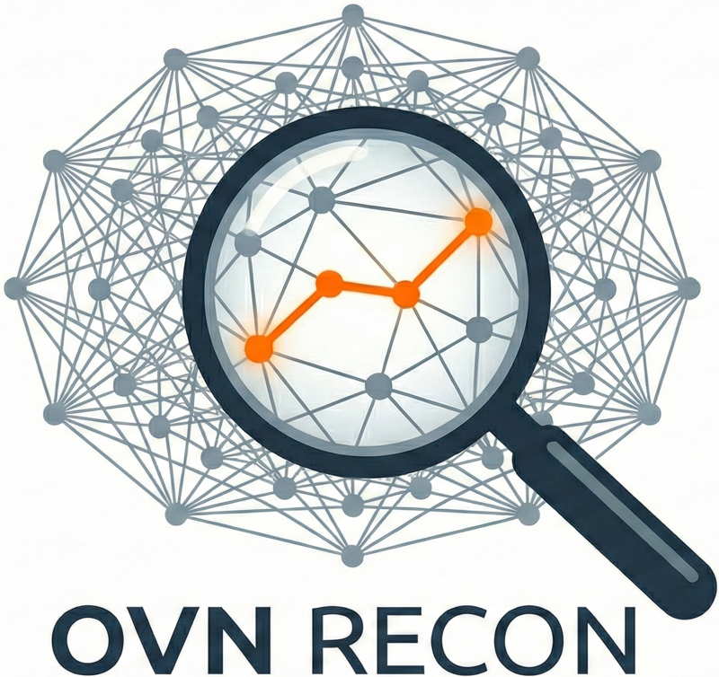
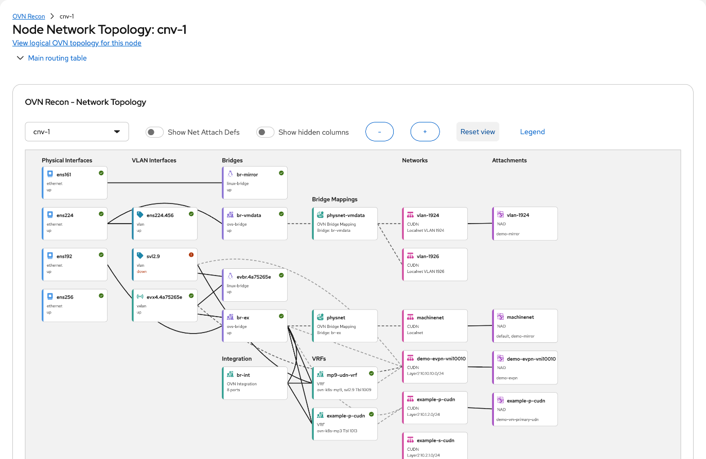
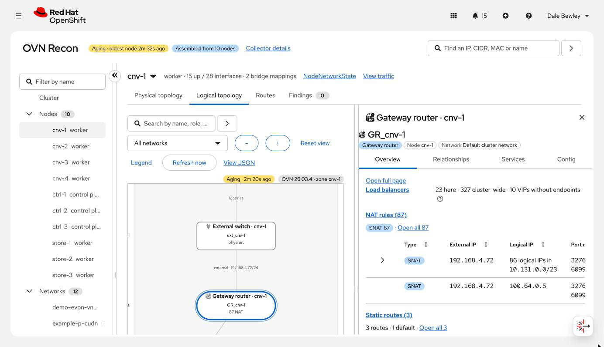
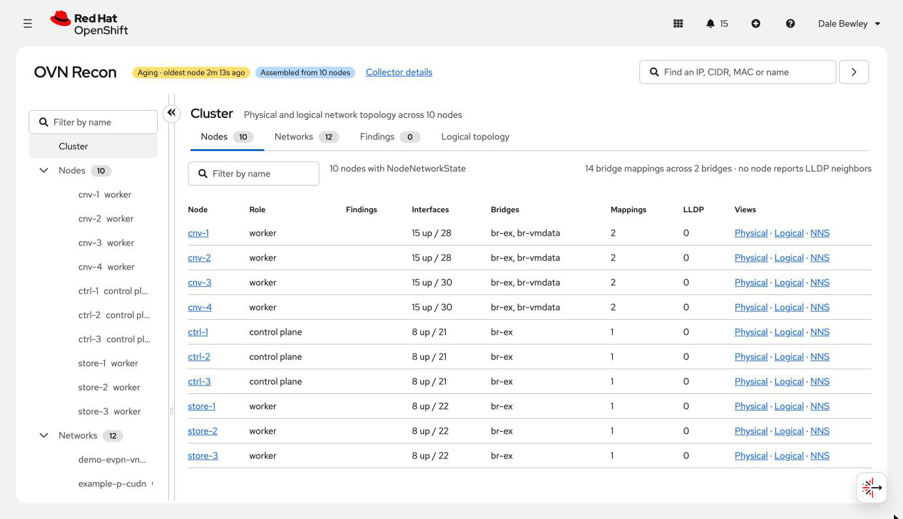
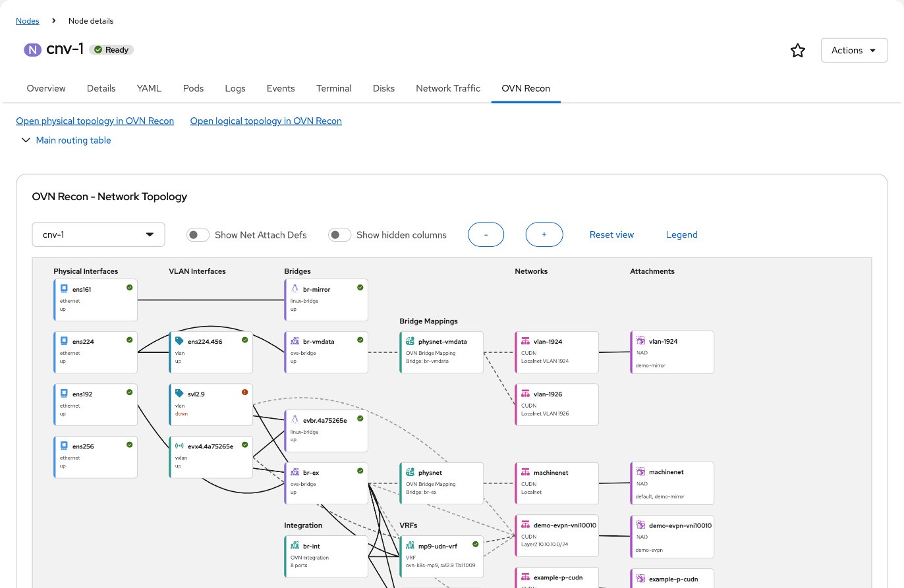
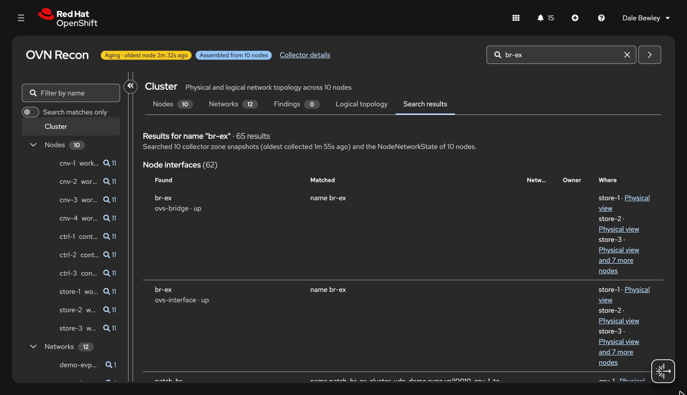

[](https://github.com/dlbewley/ovn-recon/actions/workflows/build-test.yaml)
[](https://github.com/dlbewley/ovn-recon/releases)

[](https://quay.io/repository/dbewley/ovn-recon)

# Open Virtual Network Reconnaissance (OVN Recon)

<div align="left">
<a href="img/logo-full.png"></a>
</div>
<div align="right">
<p align="center"><b>Screenshots</b></p>
<a href="img/physical-topology.png"></a>
<a href="img/logical-topology-router.png"></a>
<a href="img/explorer-cluster.png"></a>
</div>

<br clear="all"/>

**Open Virtual Network Reconnaissance (OVN Recon) is an OpenShift Console Plugin that provides a visualization of the Virtual and Node Network State in an OpenShift cluster.**

Blog post: [OVN Recon: Making OpenShift Networking Connections](https://guifreelife.com/blog/2026/02/18/OVN-Recon-Making-OpenShift-Networking-Connections/)

## Feature Highlights

- **Physical topology view**: per-node graph of host interfaces, bonds, VLANs, bridges, OVN bridge mappings, VRFs, CUDNs/UDNs, attached namespaces and NADs, with LLDP neighbours, SR-IOV virtual functions and EVPN devices where present. Kernel routes are shown as tables. See [readme-visualization.md](readme-visualization.md).
- **Logical topology views**: cluster-scoped and node-scoped ladder views of the logical OVN constructs per network, with drawers for NAT, static routes, ports, policy and Services, and a full-width detail page per switch and router. See [readme-logical-visualization.md](readme-logical-visualization.md).
- **One explorer**: a tree of the cluster, its nodes and its networks beside the selected object's views, as tabs.
- **Network views**: every CUDN, UDN and NAD in one list, and a view per network that says on which nodes it is wired.
- **Find in cluster**: search an IP address, CIDR, MAC or name across every node and open the result in the right view.
- **Findings**: flags what looks broken, such as a Localnet network whose physical network no node maps to a bridge, with the evidence and a suggested remedy.
- **Shareable views**: the selected object is kept in the page URL, so any view can be linked to.
- **Optional console integration**: an OVN Recon tab and action on the console's own Node and network pages, off by default.
- **Operator-managed lifecycle**: recommended installation via the OVN Recon Operator with automatic console plugin enablement and collector wiring.

## Installation

> [!WARNING]
> **Experimental / No warranty.** This project is experimental, community-maintained, and is **not endorsed or supported by Red Hat**. OVN Recon is provided "as is" with no warranty. Installing or using it may affect your cluster; you assume all risk. Test in a non-production environment first. The authors are not responsible for any damage, downtime, or data loss.

### Operator Installation (recommended)

#### GUI Operator Installation Method

- Click the ➕ icon at the top right of the OpenShift Console
- Select "Import YAML"
- Paste in this YAML: <https://raw.githubusercontent.com/dlbewley/ovn-recon/refs/heads/main/manifests/catalogsource.yaml>
- After a few moments navigate to "Ecosystem -> Software Catalog" (or Operator Hub in older versions)
- Search for "OVN Recon Operator"
- Click install and accept the defaults
- After a few moments click the tile to create a "ovnrecon" resource and accept the defaults
- After a few more moments a new "OVN Recon" menu will show up within the Networking menu.

### Deep Console Integration (off by default)

OVN Recon can add an **OVN Recon** tab and an **Open in OVN Recon** action to the console's own
Node, ClusterUserDefinedNetwork, UserDefinedNetwork and NetworkAttachmentDefinition pages. Both
are **off by default**, so installing or upgrading OVN Recon changes nothing on those pages. An
administrator turns them on, for every console user at once, in the `OvnRecon` resource:

```bash
oc patch ovnrecon ovn-recon --type=merge -p '{
  "spec": {
    "consolePlugin": {
      "integration": { "resourceTabs": true, "resourceActions": true }
    }
  }
}'
```

Set either back to `false` to remove it. Users who may not read `OvnRecon` resources do not see
the tabs or actions. See [OPERATOR.md](OPERATOR.md#console-integration) for details.

<a href="img/console-node-tab.png"></a>


### Logical Topology View (Collector)

The collector — and with it the logical OVN topology views — is **enabled by
default**: an `OvnRecon` resource with no `spec.collector.enabled` value
deploys the collector automatically. To opt out, disable it explicitly:

```bash
oc patch ovnrecon ovn-recon --type=merge -p '{
  "spec": {
    "collector": { "enabled": false }
  }
}'
```

You can also set collector image fields (`spec.collector.image.repository|tag|pullPolicy`) as needed. See [OPERATOR.md](OPERATOR.md) for full API details.

The `OvnRecon` spec stays as sparse as you wrote it: the CRD declares no defaults, the
operator applies them at reconcile time, and the values it actually resolved (images,
enabled flags, cache backing) are published under `status.effective`:

```bash
oc get ovnrecon ovn-recon -o jsonpath='{.status.effective}' | jq
```

#### Collector Snapshot Caching

The collector caches each node's OVN snapshot on disk. Requests are served
from cache immediately — a stale entry is returned at once while a
background refresh revalidates it — and a startup sweep warms any missing
entries, so page loads never block on live collection. Refresh is
demand-driven: an idle collector runs no probes. When live probing fails,
cached data keeps serving in preference to fixtures.

Caching is on by default, and by default it is **PVC-backed**: the operator
creates and owns a claim (managed mode) so cached snapshots survive pod
restarts — which is exactly when stale-serve matters, such as a restart
during an OVN outage. If the cluster cannot provision the claim (no default
StorageClass, or the claim stays unbound), the collector **falls back to
EmptyDir automatically** and the operator records a Warning event on the
`OvnRecon` resource (`oc describe ovnrecon` shows it). Everything is
configurable under `spec.collector.cache`:

```yaml
spec:
  collector:
    cache:
      enabled: true      # default
      ttlSeconds: 120    # freshness window; minimum 30
      storage:
        mode: auto       # default; or EmptyDir | PVC
        managed: true    # default; operator creates and owns the claim
        # claimName: collector-cache # bring your own claim
        # size: 1Gi                  # managed claim size
        # storageClassName: ""       # managed claim class; empty = cluster default
```

- **`mode: auto`** (default) uses a PVC — the managed claim, or `claimName`
  — and falls back to EmptyDir with a Warning event when the claim cannot
  be provisioned. The fallback reverses on its own once the claim binds.
- **`mode: EmptyDir`** never creates or mounts a PVC, even with `managed:
  true`; the cache re-warms after each pod restart. An existing managed
  claim is kept (dormant) so switching back keeps its contents.
- **`mode: PVC`** requires persistent storage and never falls back —
  provisioning problems are surfaced instead of papered over.
- **Managed claims** (`managed: true`, the default) are created and owned by
  the operator: default name `<collector>-cache`, RWO, `size` default `1Gi`
  (generous only because some provisioners enforce minimums; the cache
  itself needs a few MiB). The claim is garbage-collected with the
  `OvnRecon` resource and removed if you set `managed: false`; it survives
  a collector disable so the cache stays warm across toggles.
- To use a **pre-created claim** instead, set `managed: false` with
  `claimName`. With a non-RWX claim (managed claims included) the operator
  switches the collector to a `Recreate` rollout (a brief gap per upgrade,
  instead of risking a volume-attach deadlock); a pre-created RWX claim
  keeps zero-gap rolling updates.

## Alternative Installation Methods

### CLI Operator Installation

Create the Bewley Operators [catalog source](manifests/catalogsource.yaml)

```bash
oc apply -f manifests/catalogsource.yaml
```

Create the [operator subscription](manifests/operator/base).

```bash
oc apply -k manifests/operator/base
```

Create the `ovnrecon` [resource instance](manifests/instance/base) to enable console plugin and deploy OVN Recon application.

```bash
oc apply -k manifests/instance/base
```

Console plugin will be automatically enabled.

For detailed operator deployment instructions, please see [docs/OLM-BUNDLE-GUIDE.md](docs/OLM-BUNDLE-GUIDE.md).

### Manual Installation

Create the namespace, consoleplugin, service, and deployment from [manifests/manual/base](manifests/manual/base) without an operator.

```bash
oc apply -k manifests/manual/base
```

#### Enable the Console Plugin

> [!NOTE]
> When installing via the Operator, this step is not necessary.

Patch the Console Operator config to enable the plugin. Use a JSON patch to append to the list of plugins instead of replacing it:

```bash
oc patch console.operator.openshift.io cluster --type=json \
    --patch '[{"op": "add", "path": "/spec/plugins/-", "value": "ovn-recon"}]'
```

The OpenShift console will reload to apply the changes. You should see a notification that the console has been updated.

## Kubernetes Resource Dependencies

OVN Recon visualizes the following Kubernetes Custom Resources:

- **NodeNetworkState (NNS)** - Represents the current network configuration of a node, including interfaces, bridges, and OVN bridge mappings. Provided by the [nmstate operator](https://nmstate.io/).
- **NodeNetworkConfigurationPolicy (NNCP)** - Defines desired network configuration for nodes. Used to configure OVN bridge mappings and physical network interfaces.
- **ClusterUserDefinedNetwork (CUDN)** - Defines overlay networks that can be attached to pods. Part of OpenShift's [OVN-Kubernetes secondary networks](https://docs.openshift.com/container-platform/latest/networking/ovn_kubernetes_network_provider/about-ovn-kubernetes.html).
- **UserDefinedNetwork (UDN)** - Namespace-scoped network definitions used by secondary network workflows.
- **NetworkAttachmentDefinition (NAD)** - Multus CNI resource that references a CUDN and allows pods to attach to secondary networks.
- **RouteAdvertisements** - Cluster-scoped route advertisement policy objects used for VRF-to-network relationships.
- **VTEP** - Cluster-scoped EVPN tunnel endpoint pool. Used to say which VTEP a node's VXLAN device and EVPN bridge belong to, and which EVPN networks ride on it. Optional: absent on clusters without EVPN.
- **Node** - Only the node being viewed, and only its `k8s.ovn.org/vteps` annotation, which records the address OVN-Kubernetes discovered for each VTEP on that node. Optional.
- **NodeNetworkConfigurationEnactment** - Shows which NodeNetworkConfigurationPolicy configured an interface and whether a policy is failing on the node. Optional.
- **SriovNetworkNodeState** - Virtual function pools and drivers on a node. Optional: absent on clusters without the SR-IOV operator.
- **Service and EndpointSlice** - Read only when a Service row is expanded in the logical view's Services tab, to show its type and resolve backends to pods.
- **OvnRecon** - Operator custom resource that controls plugin/collector deployment and logical topology feature gating.

The plugin watches these resources in real-time and renders interactive physical/logical topology views to show how interfaces, bridges, networks, routes, and attachments are connected.

## Using OVN Recon

OVN Recon is one page, reached from *Networking → OVN Recon*. A title row carries the
collector's status and the cluster search box. Below it, a tree of the cluster, its nodes and
its networks sits beside the views of whatever is selected:

- **Cluster**: tabs for Nodes (a node table with per-node facts), Networks (every CUDN, UDN and
  NAD, findings first, with the number of nodes each is wired on), Findings (every finding grouped
  by rule) and Logical topology (with the collector on).
- **A node**: Physical topology, Logical topology (with the collector on), Routes (its main routing
  table) and Findings. The node's name is a switcher that keeps the tab.
- **A network**: its findings, a summary of its spec and a per-node placement table.

The tree can be resized by dragging its divider or with the arrow keys, and collapsed to a rail.
Its width and whether it is collapsed are kept in your console user settings; on a narrow window
it starts collapsed. Badges in the tree count findings, and while a search is open, matches.

<a href="img/explorer-cluster.png"></a>
<a href="img/explorer-search-dark.png"></a>

Every view has its own URL:

| Path | View |
|---|---|
| `/ovn-recon` | Cluster, Nodes tab |
| `/ovn-recon/node-network-state` | Cluster, Nodes tab (kept for older bookmarks) |
| `/ovn-recon/networks` | Cluster, Networks tab |
| `/ovn-recon/findings` | Cluster, Findings tab |
| `/ovn-recon/ovn` | Cluster, Logical topology tab (collector) |
| `/ovn-recon/search` | Cluster, Search results tab (`?q=` holds the search) |
| `/ovn-recon/node-network-state/:name` | A node's physical topology |
| `/ovn-recon/node-network-state/:name/routes` | A node's routing table |
| `/ovn-recon/node-network-state/:name/findings` | A node's findings |
| `/ovn-recon/ovn/:name` | A node's logical OVN topology (collector) |
| `/ovn-recon/ovn/:node/:kind/:name` | One logical switch or router from one node's zone, as full-width tables (collector) |
| `/ovn-recon/networks/cudn/:name` | A ClusterUserDefinedNetwork |
| `/ovn-recon/networks/udn/:namespace/:name` | A UserDefinedNetwork |
| `/ovn-recon/networks/nad/:namespace/:name` | A NetworkAttachmentDefinition |

An old `/ovn-recon?q=` link opens the search results.

- **Find in cluster**: type an IP address, a CIDR, a MAC, or part of a pod, VM, network or interface
  name and press Enter. Results are grouped by kind (pod and VM ports, router ports, NAT rules, Service
  VIPs, node interfaces, routes) and each opens the logical or physical view with the object selected.
  Routes and subnets that only contain the address are folded into a separate, collapsed section. The
  search stays open while you follow its results, until you clear the box, and the tree marks the nodes
  and networks that hold results. OVN objects are searched by the collector; with the collector disabled
  the search still covers every node's NodeNetworkState and says the result is partial.
- **Findings**: each finding links to the object it is about; the tree's badges and every Findings tab
  read the same evaluation. A switch hides info-level findings.
- **Switch or router detail**: a drawer's **Open full page** link opens the construct's own view.
- **Linking to a selection**: selecting an object adds `?select=` to the URL (for example `?select=iface:br-ex` on the physical view or
  `?select=switch:join` on a logical view). Opening that URL selects the object again.

In the physical node graph:
- LLDP neighbors are rendered in a dedicated optional column left of physical interfaces.
- The `Show LLDP neighbors` toggle appears only when LLDP is enabled on at least one interface and LLDP neighbor payloads are present.


## Troubleshooting

For troubleshooting steps, please see [docs/TROUBLESHOOTING.md](docs/TROUBLESHOOTING.md).

## How to Build

For detailed build and developer deployment instructions, please see [docs/BUILDING.md](docs/BUILDING.md).

## References

- [OpenShift Console Dynamic Plugin SDK](https://github.com/openshift/console/tree/master/frontend/packages/console-dynamic-plugin-sdk)
- [Dynamic Plugin SDK README](https://www.npmjs.com/package/@openshift-console/dynamic-plugin-sdk)
- [PatternFly React Documentation](https://www.patternfly.org/v4/components)
- [OpenShift Console GitHub Repository](https://github.com/openshift/console)
- [Example ocp-console-plugin](https://github.com/dlbewley/ocp-console-plugin)
