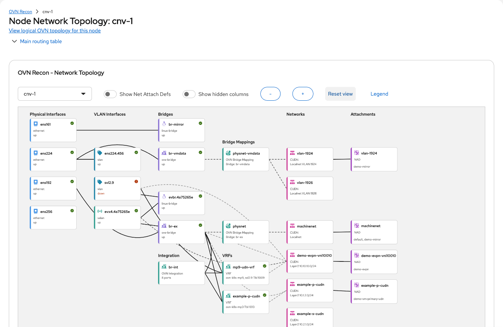
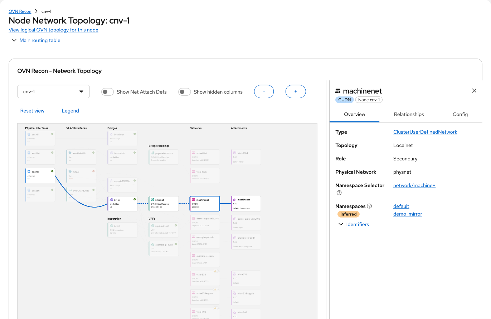

# Physical Node Visualization

This document explains the **physical topology view** at
`/ovn-recon/node-network-state/:name`, a node's **Physical topology** tab in the
OVN Recon explorer: what it draws, where each thing comes from, and how far to
trust each line. Its logical-view counterpart is
[readme-logical-visualization.md](readme-logical-visualization.md).

## What the view is for

One node's network as **nmstate** reports it, read left to right from the wire
to the workloads: physical interfaces, what is built on them (bonds, VLANs,
bridges), the names OVN uses for those bridges, and the networks and namespaces
that ride on them. It answers "which networks does this NIC carry?" and "what
is this network standing on, on this node?".

The view stops where OVN-Kubernetes takes over. What OVN builds inside its
northbound database (logical switches, routers, ports) is the logical view.

## Data sources

Everything is read from the Kubernetes API with live watches. No agent runs on
the node.

| Resource | Used for |
|---|---|
| `NodeNetworkState` of the viewed node | Interfaces, bonds, VLANs, VXLAN devices, bridges and their ports, VRFs, LLDP neighbours, kernel routes, OVN bridge mappings |
| `NodeNetworkState` of every node | The explorer's node list and node switcher, and findings that need the whole cluster |
| `ClusterUserDefinedNetwork`, `UserDefinedNetwork` | The Networks lane and the namespaces attached to each network |
| `NetworkAttachmentDefinition` | The NADs lane, the network a NAD belongs to, SR-IOV resource names |
| `RouteAdvertisements` | Which networks a VRF advertises |
| `NodeNetworkConfigurationEnactment` | Which NNCP configured an interface, and failing policies |
| `SriovNetworkNodeState` | Virtual function pools and drivers. Optional |
| `VTEP`, and the viewed `Node`'s `k8s.ovn.org/vteps` annotation | EVPN tunnel endpoints. Optional |

A resource whose CRD is absent is skipped; the view draws what it has.

## Lanes

Nodes sit in fixed lanes, in this order. A lane appears only when it has
something in it, unless noted.

| Lane | Holds | Notes |
|---|---|---|
| LLDP Neighbors | The device at the far end of each cable | Behind **LLDP neighbors** in **View options**, offered only when LLDP data exists |
| Physical Interfaces | Ethernet devices | |
| Virtual Functions | SR-IOV virtual functions present on the host | |
| Bonds | Bond interfaces | |
| VLAN Interfaces | VLAN and VXLAN devices | |
| Bridges | Linux and OVS bridges, and under an **Integration** heading the OVN integration bridge | The integration bridge is derived from its ports; nmstate does not report it as a bridge |
| Logical Interfaces | OVS internal ports | Hidden unless **Hidden columns** is checked in **View options** |
| Bridge Mappings and VRFs | The names OVN uses for a bridge, and VRF devices | One lane with two headings |
| Networks | CUDNs and UDNs | |
| Attachments | The namespaces attached to each network | Always shown |
| NADs | NetworkAttachmentDefinitions | Behind **Net Attach Defs** in **View options** |

Interfaces that fit no lane (loopback, the Geneve tunnel device) are listed in
an **Other Interfaces** grid below the lanes.

## What a line means

Every edge has a **kind**, which the stroke shows and the legend explains:

| Kind | Meaning | Example |
|---|---|---|
| membership | The source is a port of, or a member of, the target | A NIC is a port of a bridge; a management port belongs to a VRF; a namespace is attached to a network |
| layering | Traffic is carried on the target | A VLAN interface on its base interface |
| reference | A name for the same thing, or a declaration about it. Nothing flows through | A Localnet network names a physical network; a bridge mapping names a bridge; a VRF serves a Primary network |
| peer | Two devices at opposite ends of a link | An LLDP neighbour |

Every edge and every drawer fact also carries a **provenance**:

- **observed**: read directly from the node's state.
- **declared**: stated by a resource's spec or status.
- **inferred**: matched by a convention such as a name or an ID. Inferred
  items carry an `inferred` label, and the label explains the rule that made
  the match.

The drawer's **Relationships** tab lists the selected node's edges with the
rule and the fields each was read from.

## Using the view

- **Select** a node to light up the path through it and open its drawer. The
  drawer sits beside the graph, which adjusts to keep the selection visible.

  

- **Link** to a selection: the URL carries `?select=`, for example
  `?select=iface:br-ex`, `?select=vrf:blue`, `?select=cudn:blue`,
  `?select=udn:ns1/blue` or `?select=nad:ns1/blue`. An unknown value is
  ignored.
- **Toolbar** (the same one the logical views use): **View options**, a menu of
  the lane toggles above and **Hide info findings**; zoom out, zoom in and
  **Reset view** as icon buttons; and **Legend**.
  The node's name in the header above the tabs switches to another node and
  keeps the tab.
- **Routes**, the node's next tab, lists its main kernel table and marks which
  default route is in use when there is more than one. An interface in it opens
  this view with the interface selected.

## The drawer

Three tabs:

- **Overview**: findings first (see below), then the node's facts. Route
  tables appear where they apply: a VRF shows its own table, and an interface
  or bridge shows the routes that leave through it. Bonds show their mode and
  members, SR-IOV devices their virtual functions, and networks their
  topology, role, subnets and namespaces.
- **Relationships**: every edge of the selected node as a link that moves the
  selection.
- **Config**: the underlying resource as YAML.

## Findings

The view flags what looks broken, such as a Localnet network whose physical
network no node maps to a bridge. A finding shows as a badge on the graph node,
at the top of that node's drawer with its evidence and a suggested remedy, on
the node's Findings tab, as a badge on the node in the explorer's tree, and on
the cluster's Findings tab.

The rules, and the list of things deliberately not flagged, are in
[src/insights/README.md](src/insights/README.md).

## Where the code lives

| Concern | Module |
|---|---|
| Lanes | `src/topology/lanes.ts` |
| Node kinds and the edges each emits | `src/topology/descriptors.tsx` |
| Edge kinds and provenance | `src/components/nodeVisualizationModel.ts` |
| Relationship selectors | `src/components/nodeVisualizationSelectors.ts` |
| Drawer facts | `src/topology/registry.ts`, `src/topology/facts.tsx` |
| Kernel route ordering | `src/components/kernelRoutes.ts` |
| Rendering | `src/components/NodeVisualization.tsx` |
